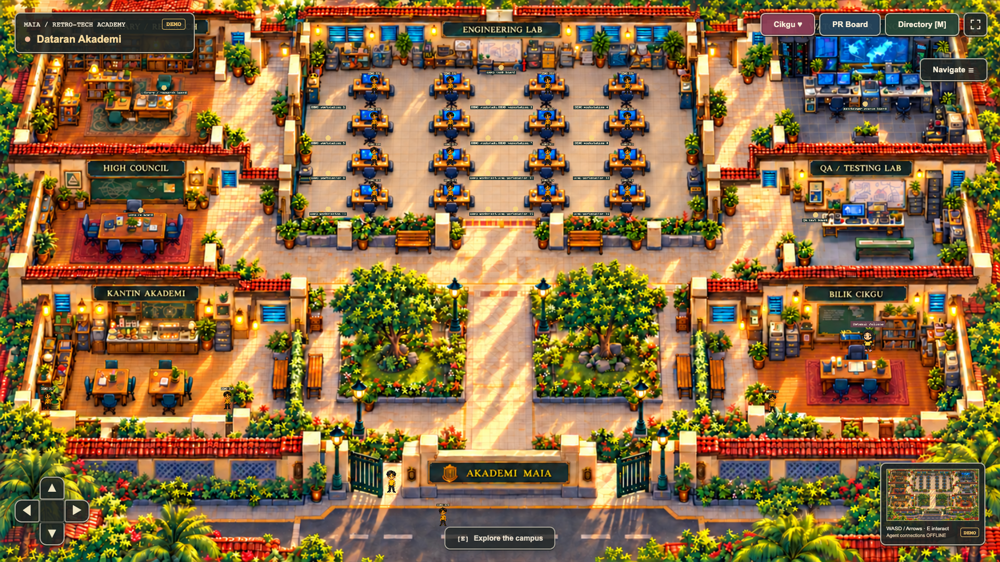

# MAIA Retro-Tech Academy

An original, playable Malaysian retro-school campus: explore as your own visitor,
meet a scripted teacher and inspect a clearly labeled demonstration PR whiteboard.
An independent personal, unofficial showcase by Azib. No production integration.

**One continuous illustrated campus, with all seven rooms visible together. Local DEMO only.**

Draft checkpoint: browser acceptance is incomplete. See the [next-session handoff](docs/handoffs/2026-10-22-next-session.md) for passing checks, remaining failures and the asset inventory.



## Play locally

```sh
npm ci
npm run build
npm start
```

Open **http://127.0.0.1:3000**. Walk with WASD/arrows or the touch D-pad.
Approach the teacher or whiteboard and press E or tap Interact. Escape closes
panels; M opens the campus directory. The directory focuses the camera while the
visitor stays in place. Walk through the open verandah entrances to reach rooms.
Navigate opens camera, mock population and geometry inspection controls. The fullscreen button
toggles browser fullscreen where supported. No account is required.

- Warm illustrated High Council, Engineering Lab, Library, Watchtower, QA Lab, Kantin and Bilik Cikgu in one world.
- Seven physical room entrances, 16 lab workstation approaches, two Kantin tables and a serving counter.
- A registered full-campus map, overview, free camera, player/DEMO actor follow, wheel/pinch zoom and collision diagnostics.
- Animated Sprinter explorer, Tiled foot collision and touch controls.
- Stationary Ustazah Juliana using the owner’s Medalist sprite, with friendly Malay dialogue.
- React whiteboard with clearly marked demo lessons; no live GitHub claims.
- Separate authenticated localhost-only operator skeleton on port 3100.

Use Node 24 LTS (or >=22.12). See the [runbook](docs/RUNBOOK.md) for operator setup
and [architecture](docs/ARCHITECTURE.md) for the isolation boundary.

## Verification

```sh
npx playwright install chromium
npm run check
npm audit --audit-level=high
npm run audit:secrets
```

Gitleaks is required for the final command. Tests exercise actual Chromium
keyboard/touch interaction, route traversal, collision, modal focus, offline
behavior, XSS handling, private-route denial and operator authentication.

[Unified campus registration](docs/unified-campus-route-report.md) ·
[Unified campus execution plan](docs/superpowers/plans/2026-10-21-unified-campus.md) ·
[Historical navigation milestone](docs/NAVIGATION_MILESTONE.md) ·
[Navigation inventory and circulation plans](docs/navigation/README.md) ·
[Runtime evidence](docs/navigation/runtime.md) ·
[Earlier redesign evidence](docs/REDESIGN.md) · [Sprint 0 evidence](docs/SPRINT_0.md)

## Scope

The campus uses an approved original generated environment and the owner’s
authorized custom Sprinter and Medalist sprites. The selected environment is
native 1670×941 mapped to a logical 3840×2160 world, with matching Tiled geometry.
Higher-resolution production art, foreground masks, an animated specialist cast,
seated/dining behavior, real authorized GitHub queries,
server-side public allowlist projection, optional sanitized live events and
Cloudflare Tunnel remain later milestones. No deployment or live integration is
claimed. No employer source, customer data or private metrics are present.

License decision: official MIT Phaser/React template structure; fresh mechanics
and original environmental art. Custom sprite permissions are documented
separately from the code license. No Agent Town source or assets are included.
See [audit](docs/ADR/001-upstream.md) and [asset registry](docs/ASSET_LICENSES.md).

The public read-only app and authenticated local operator are separate processes.
Real GitHub queries, live agent feeds and Cloudflare deployment are later stages.
