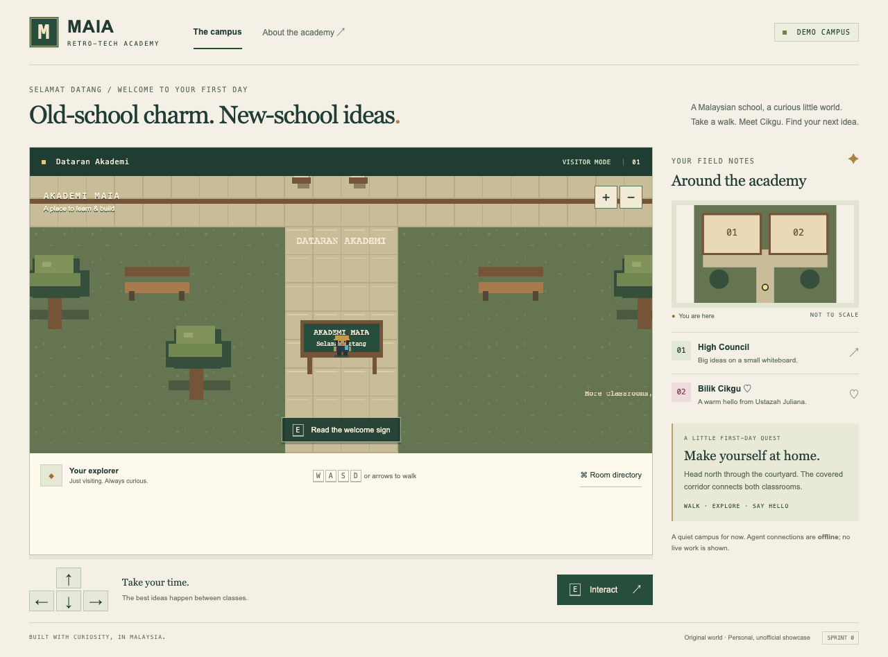

# MAIA Retro-Tech Academy

An original, playable Malaysian retro-school campus: explore as your own visitor,
meet a scripted teacher and inspect a clearly labeled demonstration PR whiteboard.
An independent personal, unofficial showcase by Azib. No production integration.

**Sprint 0: playable local technical slice. No public deployment exists.**



## Play locally

```sh
npm ci
npm run build
npm start
```

Open **http://127.0.0.1:3000**. Walk with WASD/arrows or the touch D-pad.
Approach the teacher or whiteboard and press E or tap Interact. Escape closes
panels; the room directory offers quick navigation. No account is required.

- Original Tiled campus blockout: courtyard, covered corridor, two classrooms.
- Independent explorer, foot collision, camera follow and touch controls.
- Stationary Ustazah Juliana with friendly Malay dialogue.
- React whiteboard with clearly marked demo lessons; no live GitHub claims.
- Separate authenticated localhost-only operator skeleton on port 3100.

Use Node 24 LTS (or >=22.12). See the [runbook](docs/RUNBOOK.md) for operator setup
and [architecture](docs/ARCHITECTURE.md) for the isolation boundary.

## Verification

```sh
npx playwright install chromium
npm run check
npm audit --audit-level=high
npm run audit:secrets
```

Gitleaks is required for the final command. Tests exercise actual Chromium
keyboard/touch interaction, route traversal, collision, modal focus, offline
behavior, XSS handling, private-route denial and operator authentication.

[Whiteboard screenshot](docs/evidence/whiteboard-desktop.png) ·
[Teacher screenshot](docs/evidence/teacher-desktop.png) ·
[Mobile screenshot](docs/evidence/campus-mobile.png) ·
[Sprint evidence](docs/SPRINT_0.md)

## Scope

Art is deliberately original placeholder art for the technical spike. Final
campus expansion, animated specialist cast, real authorized GitHub queries,
server-side public allowlist projection, optional sanitized live events and
Cloudflare Tunnel remain later milestones. No deployment or live integration is
claimed. No employer source, customer data or private metrics are present.

License decision: official MIT Phaser/React template structure; fresh mechanics
and original placeholder graphics. No Agent Town source or assets are included.
See [audit](docs/ADR/001-upstream.md) and [asset registry](docs/ASSET_LICENSES.md).

The public read-only app and authenticated local operator are separate processes.
Real GitHub queries, live agent feeds and Cloudflare deployment are later stages.
