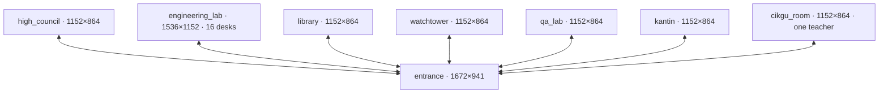

# Navigation-first campus inventory

This is a **temporary navigation study**, with seven separate low-detail rooms and the preserved illustrated entrance. Static geometry passes are evidence for ST-NAV-01; real keyboard/touch traversal remains Task 2. No new final environment artwork was generated.

The canonical source is `packages/world/scenes.ts`. Both Tiled formats, route evidence and diagrams are generated with `npm run scenes:generate`. `packages/world/tiled.ts` reconstructs the complete typed room from the JSON object layers; tests compare that result to the source catalog. Runtime can consume those exported objects without inventing another set of rectangles.

All links are reciprocal. Room exits share a 144-unit south opening and an explicit floor-transfer pad inside that opening. The entrance's new markers are **floor transfers**, with E/touch activation, not claims that painted walls conceal walkable doors. Upper rooms are now west/east transfer vestibules. The previous entrance PR board and teacher object anchors are migrated to canonical `high_council` and `cikgu_room`; the accepted entrance plate and all 22 collision objects, including their IDs, are unchanged. Legacy `gate`, `council`, `teacher` resolve to those canonical scene IDs explicitly. Only `cikgu_room.npcs` owns `npc_cikgu`.

| Destination     | Entrance pad x,y,w,h | Return feet | Room entry feet | Room exit pad x,y,w,h |
| --------------- | -------------------- | ----------- | --------------- | --------------------- |
| high_council    | 582,249,96,32        | 630,310     | 576,720         | 504,792,144,36        |
| engineering_lab | 590,638,144,32       | 744,694     | 768,1008        | 696,1080,144,36       |
| library         | 252,249,96,32        | 300,310     | 576,720         | 504,792,144,36        |
| watchtower      | 428,369,96,32        | 476,435     | 576,720         | 504,792,144,36        |
| qa_lab          | 972,249,96,32        | 1020,310    | 576,720         | 504,792,144,36        |
| kantin          | 1152,369,96,32       | 1200,435    | 576,720         | 504,792,144,36        |
| cikgu_room      | 1322,249,96,32       | 1370,310    | 576,720         | 504,792,144,36        |

Every destination `targetSpawn` is `entry`. Every reverse transition targets `entrance.spawns.from_<room id>`. All landings clear all portal rectangles by the complete conservative foot envelope. A landing may remain near the portal; runtime must require a new interaction edge, release/rearm and transition lock to prevent held-key retriggers. Entry starts at the gate's existing (836,660). The lab entrance return moved east to (744,694), avoiding the noticeboard, the west flowerbed and its own 144-wide portal pad.

New rooms reserve a 240-unit central spine and a 144-unit south cross-aisle. All new south door gaps are 144. Lab desks are 144×72, in four rows and four columns; row gaps and the two side column gaps are 120. Station approach feet sit 54 units beyond the desk edge; worker feet sit 24 units beyond it, leaving the visitor approach reachable with occupied seats. Sixteen stations are `station-01` through `station-16`, ordered by row then column. The room's task board is at (768,120). Other required fixtures include council PR/supervisor, four library reading positions, four monitoring screens, six QA terminals, eight kantin seats and service counter, and teacher dialogue at (576,324) facing the stationary teacher at (576,264).

**Entrance exceptions:** inherited indoor horizontal strips between desk bottoms y=300 and front walls y=325 are only 25 units high. West and east vestibule doors are 125 and 135 wide. The upper center corridor is 90 wide; courtyard paths beside the noticeboard narrow to approximately 80–85. These are accepted existing-art exceptions, not new-room clearance claims. The entrance has no falsely labeled 192–240-unit reserved lane. Static reachability preserves the baseline collision, but continuous real Phaser walking through its narrowest turns still requires Task 2 evidence.

The current player is a 192×208 frame at scale .44, origin (.5,.94), body 32×18 with offset (80,184). Installed Phaser 3.90 `Body.updateFromGameObject()` and `setSize()` give world feet x[-7.04,+7.04], y[-5.0688,+2.8512] relative to sprite position. `FOOT_BODY` records this exact transform and a conservative x[-8,+8], y[-6,+4] envelope for planning. Runtime should retain these source dimensions/origin/scale; `sprite.x,y` are foot reference coordinates. Bounds remain exact world dimensions, independent of the 48-unit editing grid and future background image resolution.

`findRoute` uses an authoritative-solid 12-unit graph with continuous slab segment checks and final segment simplification. It accepts temporary occupancy separately. It returns `null` for static or transient blockage; `planActorRoute` instead reports an explicit wait with a reachable clear overflow target when available. Clearing transient occupancy restores routes. Dynamic actors must never become permanent scene solids.

`createDemoActors(4|12|20|...)` creates stable DEMO IDs/tasks, independent of render capacity. `reserveDemoWorkstations` places the first 16 in lab seats, two overflow workers in council, two in library, then four in lab overflow, all outside reserved lanes. Additional workers remain tracked with `position:null` / `anchorId:null`; visual availability never changes `workState:demo-running`. This registry has no private source, connector, session or live data.

The [route report](route-report.md), [full waypoints](routes.json) and [per-anchor clearances](anchor-clearances.md) are generated evidence. Per-room diagrams show solids in gray, reserved aisles in green, floor transfers in yellow, approaches as colored dots and landings as red circles:

- [Entrance](entrance.svg)
- [High Council](high_council.svg)
- [Engineering Lab](engineering_lab.svg)
- [Library](library.svg)
- [Watchtower](watchtower.svg)
- [QA Lab](qa_lab.svg)
- [Kantin](kantin.svg)
- [Cikgu Room](cikgu_room.svg)

Unverified here: Phaser movement, room switching, held-input cleanup, touch controls, camera/HUD, foreground occlusion, browser/Safari/device performance and HD art. Legacy `Campus.ts` still expects the removed entrance NPC/PR anchors; Task 2 must migrate those references before this intermediate geometry commit is playable.
